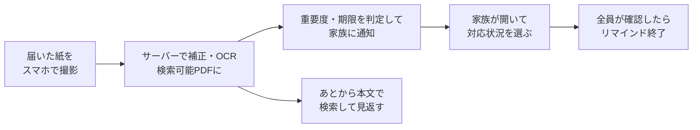
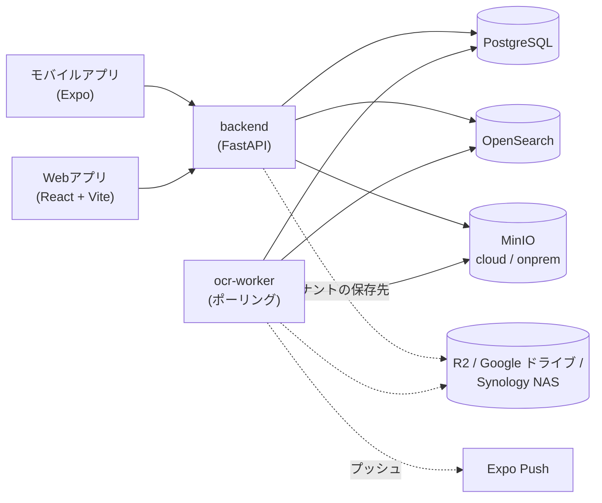

# 紙ログ

> **届いた紙を、撮って、探せて、家族で見逃さない。**

スマートフォンで紙の資料を撮影すると、補正・OCR を経て**検索できる電子ドキュメント**として保存される。OCR した本文から**重要度と期限**を判定して家族に知らせ、誰が確認したかを共有する。全員が確認したらリマインドは止まる。利用する世帯・組織ごとに**テナント**でデータを分け、公開デモと実利用を混ぜない。

> **紙ログ** は本システムの呼称です（旧称: 紙媒体電子管理システム）。
> リポジトリ名・パッケージ名（`dms-web` / `dms-mobile`）・Docker サービス名などの識別子は変更していません。

## コンセプト

学校のプリント、請求書、役所の通知といった紙は、受け取った人しか中身を知らず、しまい込むと探せなくなる。期限のある紙ほど、家族の誰かが見逃すと困る。

紙ログは、**紙を「撮るだけ」で検索できる電子データにし、その中身から家族に知らせる**ことで、この問題をなくす。

| 考え方 | 内容 |
|---|---|
| 撮るだけで、探せる紙に | 撮影した画像はサーバーで輪郭検出・台形補正・画質補正され、OCR で検索可能 PDF になる。紙を手放しても、本文で探せる（OCR の読み違いや、ひらがなでの入力でも見つかる） |
| 大事な紙を、見逃さない | OCR 本文から重要度・期限・対象を判定し、登録した人以外の家族に知らせる |
| 誰が見たかを、共有する | 家族それぞれの既読と対応状況（確認した / 対応する / 対応済み / あとで確認）を並べて表示する。全員が確認したらリマインドを止める |
| 中身は、外に出さない | 解析はルールベースで、本文を外部サービスに送らない。プッシュ通知の本文にも書類の中身を載せない。機密の書類はオンプレミス側に保存する |
| 家族ごとに、閉じる | ユーザー・グループ・書類・通知はテナントの中に閉じる。公開デモのアカウントから実利用の書類は見えない |
| 見せる人を、カテゴリで決める | 投函チラシは全員、重要書類は子供以外、処方箋は本人だけ、のようにカテゴリごとに見られる人を決める。管理者にも同じ範囲を当てはめる |

| 項目 | 内容 |
|---|---|
| ステータス | **フェーズ1〜4（認証・撮影・OCR・検索）、フェーズ9（家族での共有・通知）、フェーズ10（テナント分離）、フェーズ13（カテゴリと公開範囲）の主要機能を実装済み**（[開発ロードマップ](#14-開発ロードマップ)） |
| 公開デモ | https://document.makoto-kamimura.com （デモ用アカウントの案内はポートフォリオ側に掲載） |
| 作成者 | **Makoto Kamimura** — [@makoto-kamimura](https://github.com/makoto-kamimura) |

このREADMEは、プロジェクト紹介と仕様書を兼ね、次の2部と付録で構成する。

| 部 | 内容 | 主な読者 |
|---|---|---|
| [第1部 概要説明](#第1部-概要説明) | 目的、機能と画面の仕様、要件ごとの実装状況、ロードマップ | すべての人 |
| [第2部 技術説明](#第2部-技術説明) | 技術スタック、システム構成、クイックスタート、実装方針、データモデル、API、非機能要件 | 開発者 |
| [付録](#付録) | 決定事項、未決事項 | すべての人 |

設計・計画の資料、運用手順書、タスク一覧は [docs/](docs/README.md) に種類ごとに置く。

## 目次

- [コンセプト](#コンセプト)
- [第1部 概要説明](#第1部-概要説明)
  - [特徴](#特徴) / [使い方のイメージ](#使い方のイメージ)
  - [1. 概要](#1-概要) / [2. 用語](#2-用語) / [3. ユーザー種別と権限](#3-ユーザー種別と権限) / [4. 基本フロー](#4-基本フロー) / [5. 画面一覧](#5-画面一覧) / [6. 認証とアカウント](#6-認証とアカウント)
  - [7. 撮影と取り込み](#7-撮影と取り込み) / [8. ドキュメント化とOCRと保存](#8-ドキュメント化とocrと保存) / [9. 閲覧と検索](#9-閲覧と検索) / [10. 閲覧記録](#10-閲覧記録)
  - [11. 家族での共有と通知](#11-家族での共有と通知) / [12. テナント分離](#12-テナント分離) / [13. 管理機能](#13-管理機能) / [14. 開発ロードマップ](#14-開発ロードマップ)
- [第2部 技術説明](#第2部-技術説明)
  - [15. 技術スタックとシステム構成](#15-技術スタックとシステム構成)（[クイックスタート](#156-クイックスタート)を含む）
  - [16. 認証の実装](#16-認証の実装) / [17. 機能ごとの実装方針](#17-機能ごとの実装方針) / [18. データモデル](#18-データモデル) / [19. API](#19-api) / [20. 非機能要件](#20-非機能要件)
- [付録](#付録)
  - [21. 決定事項](#21-決定事項) / [22. 未決事項](#22-未決事項)

---

# 第1部 概要説明

サービスの目的・機能・画面の仕様をまとめる。技術的な内容は[第2部](#第2部-技術説明)に分ける。要件ID（F-01〜F-41）は初期の[要件定義書](docs/design/requirements.md)に準拠する。

## 特徴

| 特徴 | 内容 |
|---|---|
| 撮影と自動補正 | 複数ページを連続撮影して1つのドキュメントにまとめる。輪郭検出・台形補正・明るさ補正・カラー / グレー / 白黒の切り替えはサーバーで行う |
| 画質チェック | ブレ・暗さ・影ムラ・解像度を判定し、低品質なら警告する |
| 検索可能 PDF | OCR のテキスト層を埋め込んだ PDF を自動で作り、保存する。日本語の縦書きにも対応する |
| 全文検索 | タイトル・OCR 本文・タグを横断して検索する。表記ゆれ・OCR の読み違い・ひらがなの読みにも対応し、該当箇所をハイライトする |
| 読み取りの精度 | 本文は PaddleOCR（PP-OCRv6）で読む（合成サンプルで文字誤り率は Tesseract の約4分の1）。検索可能 PDF のテキスト層は Tesseract。どちらもサーバー内で動き、書類を外部に送らない |
| 家族への通知 | 重要度・期限を判定して家族に知らせ、未確認の人にだけリマインドする。期限の前日にも知らせる |
| 対応状況とコメント | 家族それぞれの既読・対応状況を1画面で見られる。コメントで申し送りができる |
| 権限と共有 | 4段階のロール、ドキュメント単位の権限（閲覧 / 編集 / 削除）、同じグループのメンバーへの自動共有 |
| カテゴリと公開範囲 | 管理者がカテゴリを追加し、見られる人（全員 / 子供以外 / 家族 / 本人だけ）を決める。撮影した書類はカテゴリを選んで登録する |
| バージョン管理 | 差し替えると前の版を履歴に残し、再度 OCR する |
| ハイブリッド保存 | 機密度が「機密」の書類はオンプレミス側、それ以外はクラウド側のストレージに保存する |
| テナント分離 | デモと実利用、世帯・組織ごとにデータを分ける |

## 使い方のイメージ



## 1. 概要

### 1.1 ポジショニング

紙を電子化するスキャナーアプリと、家族の連絡を共有するアプリの中間に位置付ける。電子化した紙の**中身**をきっかけに、家族へ知らせて確認を集めるところまでを1つのアプリで行う。

当初は業務用の「紙媒体資料の撮影・電子保存・閲覧管理システム」として[要件定義](docs/design/requirements.md)した。撮影・OCR・検索・権限・閲覧記録の要件はそのまま引き継ぎ、家庭での利用（家族での共有・通知）とテナント分離を加えている。

### 1.2 原則

- **撮るのは一度だけ**：補正・OCR・解析・通知は、撮影後にサーバーが自動で行う。
- **本文を外に出さない**：文書解析はルールベースで行い、プッシュ通知には定型文だけを載せる。
- **見えてはいけないものは存在ごと伏せる**：別テナントや権限のないドキュメントには 404 を返す。

### 1.3 想定ユースケース

- 学校のプリントを撮って、提出期限を家族全員に知らせる。
- 請求書・役所の通知を撮って、支払いや手続きの担当と完了を共有する。
- 保管している紙を電子化して、後から本文で探す。

## 2. 用語

| 用語 | 意味 |
|---|---|
| ドキュメント | 撮影またはアップロードした1件の資料。複数ページを持てる |
| テナント | データ分離の最上位の単位（世帯・組織）。デモ用（`demo`）と実利用（`family`）を起動時に作る |
| 操作中のテナント | 全体管理者が、テナント管理以外の操作を行うテナント。Web の「テナント管理」でだけ切り替える。モバイルアプリも同じテナントを使う |
| カテゴリ | 書類を入れておく箱。テナントごとに管理者が追加し、公開範囲を持つ。サンプルとして「投函チラシ」「重要書類」「処方箋」を用意する |
| 公開範囲 | カテゴリの中の書類を見られる人の上限。`everyone`（全員）/ `adults`（子供以外）/ `family`（家族）/ `owner`（本人だけ）。カテゴリを選ばない書類（未分類）は `family` と同じ |
| 子供 | ユーザーに付ける印（ロールとは別）。公開範囲が「子供以外」の書類を見られない |
| グループ | テナントの中のユーザーの集まり。家族の単位として使う。同じグループのメンバーは、互いのドキュメントを自動で閲覧できる |
| 家族 | あるドキュメントを見られる人（所有者を含む）。公開範囲で決まる。「家族」と未分類は、所有者と同じグループのメンバー＋個別に共有されたユーザー。通知と確認状況の対象になる |
| 機密度 | `public` / `internal` / `confidential`。`confidential` はオンプレミス側に保存する |
| OCR ステータス | `pending`（待ち）→ `processing`（処理中）→ `done`（完了）/ `failed`（失敗） |
| 解析結果（インサイト） | OCR 本文から判定した重要度・期限・行事日・対象・キーワード・判定理由 |
| 対応状況 | 家族それぞれが選ぶ「確認した / 対応する / 対応済み / あとで確認」 |
| 確認済み | ドキュメントを開いた（既読）か、「確認した / 対応する / 対応済み」を選んだ状態。「あとで確認」は未確認として扱う |
| 権限レベル | ドキュメント単位の `view`（閲覧）< `edit`（編集）< `delete`（削除） |

## 3. ユーザー種別と権限

### 3.1 ロール

| ロール | 範囲 | できること |
|---|---|---|
| 全体管理者（`super_admin`） | テナント管理は全テナント、それ以外は操作中のテナント（テナントに属さない） | Web の「テナント管理」でだけ、テナントの作成・変更・削除、操作中のテナントの切り替え、メンバーの確認とテナント間の移動を行う。それ以外の機能は、操作中のテナントの中で管理者と同じように使う。**非公開**で、既定では作成しない（[6.2節](#62-全体管理者)） |
| 管理者（`admin`） | 自テナント | テナント内のドキュメントへのフル権限（カテゴリの公開範囲の中で）、ユーザー・グループ・カテゴリの管理、閲覧履歴の照会 |
| 登録者（`registrar`） | 自テナント | 撮影・登録、自分のドキュメントの編集、共有されたドキュメントの閲覧 |
| 閲覧者（`viewer`） | 自テナント | 共有されたドキュメントの閲覧。アップロードは現在 API で制限していない（[Q10](#22-未決事項)） |

### 3.2 ドキュメントへのアクセス判定

上から順に判定する。見られないドキュメントは存在を伏せて 404、見られるが権限が足りない操作は 403 を返す。

1. 別テナントのドキュメントは、所有者・権限・ロールに関係なくアクセスできない。全体管理者も操作中のテナントだけ。
2. 所有者は、常にフル権限を持つ。
3. カテゴリの公開範囲を上限として当てはめる。「本人だけ」は所有者以外は誰も見られない（管理者・全体管理者・個別の共有でも不可）。「子供以外」は子供の印がある人は見られない。
4. 範囲の中では、同じテナントの管理者（と操作中の全体管理者）はフル権限を持つ。
5. 個別に付与された権限（`view` / `edit` / `delete`）があれば、そのレベルまで操作できる。
6. 閲覧だけは、公開範囲が「全員」「子供以外」なら範囲の全員に、「家族」と未分類なら所有者と同じグループのメンバーに許可する（グループ自動共有）。

| 公開範囲 | 見られる人 |
|---|---|
| 全員（`everyone`） | テナントの全員 |
| 子供以外（`adults`） | 子供の印がない全員と所有者 |
| 家族（`family`）・未分類 | 所有者・同じグループのメンバー・個別に共有した人・管理者 |
| 本人だけ（`owner`） | 所有者だけ |

## 4. 基本フロー

### 4.1 撮影から保存まで

1. モバイルアプリで撮影する（複数ページ可）。ライブラリの画像や PDF も取り込める。確認画面でタイトルとカテゴリを選ぶ（カテゴリで見られる人が決まる）。オフライン時は端末に退避し、再接続時に自動で送る。
2. サーバーがドキュメントを `pending` で登録する。
3. OCR ワーカーが、ページごとに輪郭検出・台形補正・画質補正・モード変換を行い、品質を判定する。
4. ページをまとめて OCR し、検索可能 PDF を作る。本文をストレージと検索索引に保存する。
5. 本文を解析し、重要度・期限などを保存して家族に通知する（[4.2節](#42-家族への通知)）。

### 4.2 家族への通知

1. OCR の完了後、本文から重要度・期限・行事日・対象・キーワード・分類を判定する。自動で付いたタイトル（`資料_123` など）は見出しの候補に、空の書類種別は推定した分類に置き換える。カテゴリは見られる人を決めるため、自動では付けない。
2. 登録者以外の家族（その書類を見られる人）に通知する（1書類につき1回）。「本人だけ」の書類は誰にも通知しない。
3. 家族は書類を開くか、対応状況を選ぶ。
4. 未確認の家族には一定の間隔でリマインドする。**全員が確認したら止める**。期限の前日には期限の通知を送る。
5. 家族の誰でも「もう一度通知」で未確認の人に知らせられる。コメントを付けると他の家族に知らせる。

### 4.3 検索から閲覧まで

1. 全文検索する（カテゴリ・書類種別・タグで絞り込める）。
2. テナントと閲覧権限で絞られた結果が、ハイライト付きで返る。
3. 結果のサムネイルやタイトルから、ページめくりビューアを開く。
4. 権限に応じてダウンロード・印刷する。閲覧・ダウンロード・印刷は記録される。

## 5. 画面一覧

### 5.1 Web

| 画面 | パス | 対象 | 内容 |
|---|---|---|---|
| ログイン | `/login` | すべて | メールアドレスとパスワードでログイン |
| ドキュメント一覧 | `/documents` | すべて | 一覧 / サムネイル表示、カテゴリでの絞り込み、メタデータ・カテゴリ・タグ・OCR テキストの編集、ビューア（ページ送り・ズーム・印刷）、バージョン履歴と差し替え、ドキュメント単位の権限、家族の確認状況、削除（削除できる人だけ。行のゴミ箱とビューアの「削除」から、確認してから完全に消す） |
| 全文検索 | `/search` | すべて | 横断検索、ハイライト、結果からビューアを起動 |
| お知らせ | `/notifications` | すべて | 通知の一覧、既読化、すべて既読 |
| ユーザー管理 | `/users` | 管理者 | ユーザーの作成・名前の変更・ロール変更・子供の印・パスワード再設定・削除（操作中のテナントのユーザーだけ） |
| グループ管理 | `/groups` | 管理者 | グループとメンバーの管理 |
| カテゴリ管理 | `/categories` | 管理者 | カテゴリの追加・名前の変更・アイコンと色の選択・公開範囲の変更・削除（書類が入っていないものだけ） |
| 保存先 | `/storage` | 管理者 | 書類の保存先（Cloudflare R2 / Google ドライブ / Synology NAS / S3 互換）の登録・接続テスト・切り替え |
| テナント管理 | `/tenants` | 全体管理者 | テナントの作成・変更・削除、操作中のテナントの切り替え、メンバーの確認とテナント間の移動 |

サイドバーの自分の名前を押すと、自分の表示名を変えられる（全ロール）。

テナントにかかわる設定・確認・変更は「テナント管理」にだけ置く。全体管理者は操作中のテナントを選ぶまで、ほかの画面を使えない（画面の上に案内が出る）。

### 5.2 モバイルアプリ

| 画面 | 内容 |
|---|---|
| ログイン | メールアドレスとパスワードでログイン |
| ドキュメント一覧 | 上にカテゴリ（アイコン付き、折り返して全部表示）、その下に区分（すべて / 未読 / 重要 / 期限あり / 既読）を等幅で1行に。幅の狭い端末でも横スクロールしない。一覧 / サムネイルの切り替えはヘッダー右 |
| 撮影 | 連続撮影、書類を合わせる枠の表示、撮影中と確認画面でのカテゴリの選択（見られる人を一行で表示）、カラー / グレー / 白黒の切り替え、プレビュー・並べ替え・削除、画像 / PDF の取り込み、オフライン時の退避と再送 |
| ドキュメント詳細 | 画像をタップすると全画面（ピンチ・ダブルタップで拡大、拡大中は指で移動）、複数ページのページ送り、カテゴリと画質の警告、家族の確認状況・コメント・もう一度通知、検索可能 PDF / OCR 全文 PDF の保存と共有、削除（削除できる人だけ。確認してから完全に消し、一覧へ戻る）。画面下にコメント欄と「あなたの対応」のアイコンを固定し、対応を押すと（入力中のコメントも送って）一覧へ戻る |
| 検索 | 全文検索 |
| お知らせ | 通知の一覧（未読バッジ） |
| アカウント | 各タブのヘッダー右の名前から開く。表示名の変更・アカウント情報・ログアウト |

モバイルアプリにはテナントの操作を置かない。全体管理者は、Web のテナント管理で選んだテナントの中で使う。

## 6. 認証とアカウント

### 6.1 ログイン

メールアドレスとパスワードで認証する（F-33）。多要素認証・SSO（F-34）は未対応。

### 6.2 全体管理者

全体管理者は**既定では作成しない**。運用者の既存アカウントを DB で昇格させ、テナントの所属を外して操作中のテナントにする（手順は[運用手順書](docs/runbooks/operation.md)）。`SEED_SUPER_ADMIN_EMAIL` を指定した場合だけ初回起動時に作成し、パスワードが未設定なら起動ログに1度だけ表示する。操作中のテナントが未選択の全体管理者は、起動時に実利用テナント（`family`）を操作中にする。

### 6.3 初期アカウント

| テナント | アカウント | ロール | 公開 |
|---|---|---|---|
| `demo`（デモ） | `demo@example.com` | 管理者 | **公開** |
| `demo` | `demo-registrar@example.com` | 登録者 | **公開** |
| `demo` | `demo-viewer@example.com` | 閲覧者 | **公開** |
| `demo` | `demo-child@example.com` | 登録者（子供） | **公開** |
| `family`（実利用） | `SEED_ADMIN_EMAIL`（既定 `admin@example.com`） | 管理者 | 非公開 |

- デモの4アカウントは同じグループ「デモ家族」に入り、ロールごとの見え方と、カテゴリの公開範囲（子供には「重要書類」が見えない、「処方箋」は登録した本人だけ）を試せる。アカウントの案内はポートフォリオ側に載せ、ログイン画面には出さない。
- 実利用を始めるときは、実利用テナントの管理者のパスワードを必ず変更する。

## 7. 撮影と取り込み

| No. | 要件 | 区分 | 状態 | 仕様 |
|---|---|---|---|---|
| F-01 | 端末カメラでの撮影 | 必須 | 実装済み | expo-camera で撮影（解像度はそのまま JPEG 画質 0.9・連続オートフォーカス。1回の登録は合計50MBまで）。撮影タブのボタンからカメラを開き、A4 の枠に書類を合わせて撮る。カテゴリは撮影中にも選べる。撮影後の確認画面でタイトル・カテゴリ・モード・ページを確かめて登録する（タイトルが空欄なら、OCR の後に見出しから付ける） |
| F-02 | 連続撮影と1ドキュメントへの統合 | 必須 | 実装済み | ページの配列を送り、サーバーで1つの PDF にまとめる |
| F-03 | 輪郭の自動検出とトリミング | 必須 | 実装済み | サーバーの OpenCV で輪郭を検出し、透視変換する（検出できなければ元の画像を使う） |
| F-04 | 傾き・台形の補正 | 必須 | 実装済み | 同上。OCR 時にも傾きと向きを補正する |
| F-05 | 明るさ・コントラスト・シャープネスの最適化 | 必須 | 実装済み | CLAHE とノイズ除去。シャープネスは簡易 |
| F-06 | カラー / グレー / 白黒の切り替え | 必須 | 実装済み | 撮影後の確認画面で選び、サーバーで変換する |
| F-07 | 影・映り込み・指写りの検出 | 推奨 | 一部 | 影ムラ・明るさの警告まで。指写りの検出と除去は未対応 |
| F-08 | プレビュー・再撮影・並べ替え・削除 | 必須 | 実装済み | 確認画面のサムネイル列で操作する。登録した書類は撮影タブの「最近登録した書類」にサムネイル付きで並ぶ |
| F-09 | 品質チェックと再撮影の促し | 推奨 | 実装済み | 端末で解像度、サーバーでブレ・明るさを判定する |
| F-10 | 既存の画像 / PDF の取り込み | 推奨 | 実装済み | ライブラリの画像・PDF を取り込む |
| F-11 | オフライン撮影と再接続時の同期 | 推奨 | 実装済み | 端末に退避し、復帰時に自動で再送する（手動の同期も可） |

## 8. ドキュメント化とOCRと保存

| No. | 要件 | 区分 | 状態 | 仕様 |
|---|---|---|---|---|
| F-12 | 複数ページを1つの PDF に | 必須 | 実装済み | img2pdf → ocrmypdf で1つの検索可能 PDF にする |
| F-13 | OCR によるテキスト抽出 | 必須 | 実装済み | 画像のページは PaddleOCR で読み、読めなかったページは Tesseract の結果を使う（[17.4節](#174-paddleocr-による本文の読み取り)）。NFKC 正規化・日本語の間の余分な空白の除去・カタカナの誤認識（一→ー、口→ロ など）の補正を行う |
| F-14 | 検索可能 PDF の生成 | 必須 | 実装済み | 撮影後に自動で作ってストレージに保存する。OCR 全文 PDF も出力できる |
| F-15 | 日本語（縦書き含む）・英数字の混在 | 必須 | 実装済み | `jpn+jpn_vert+eng`、高精度モデル tessdata_best |
| F-16 | OCR 結果の確認と手動修正 | 推奨 | 実装済み | Web の編集画面で修正すると、検索索引も更新する |
| F-17 | メタデータの付与 | 必須 | 実装済み | タイトル・カテゴリ（マスタから選ぶ）・書類種別・タグ・機密度を編集できる |
| F-18 | フォルダ / カテゴリの階層管理 | 必須 | 対象外 | 階層のないカテゴリとタグで代替する（[決定事項](#21-決定事項) D11） |
| F-19 | バージョン管理 | 推奨 | 実装済み | 差し替え時に現在の版を履歴に移し、版数を上げて再度 OCR する |
| F-20 | 機密度によるハイブリッド保存 | 必須 | 実装済み | `confidential` はオンプレ側、それ以外はクラウド側。機密度を変えると保存先を判定し直し、変わる場合はファイルを移す |
| F-20a | 外部ストレージ連携 | 推奨 | 実装済み | テナントごとに保存先を Cloudflare R2 / Google ドライブ / Synology NAS（WebDAV）/ S3 互換から選ぶ。[8.1節](#81-外部ストレージ連携) |

### 8.1 外部ストレージ連携

- テナントの管理者が Web の「保存先」で保存先を登録し、接続テスト（書き込み → 読み出し → 削除）に成功したものを1つ「使用中」にする。使用中の保存先は**これから登録する書類**に使い、登録済みの書類は保存した時点の保存先から読む（切り替えてもデータは移さない）。
- 何も選ばなければ、従来どおりサーバー内の MinIO に保存する。
- 機密書類（`confidential`）は、「自宅内（オンプレ）」として登録した保存先にだけ置く。使用中の保存先がクラウド（R2・Google ドライブ・オンプレ指定なし）なら、サーバー内の MinIO のオンプレ用バケットに置く。オンプレ指定ができるのは Synology NAS と S3 互換だけ。
- 書類の画像・PDF はこれまでどおりバックエンドを経由して配信する。保存先の URL やトークンを端末に渡さない。
- 保存先の認証情報（アクセスキー・パスワード・リフレッシュトークン）は暗号化して DB に保存し、API でも返さない。
- Google ドライブは OAuth で利用者自身のドライブと連携する。権限は `drive.file`（このアプリが作ったファイルだけ）で、ドライブの「紙ログ」フォルダの下に書類ごとのフォルダを作る。再連携は同じアカウントに限る。
- 機密度を変えたときは、今の保存先に置いたままでよければ動かさない。機密にした書類がクラウドの保存先にあるときだけ、オンプレ側（オンプレ指定の使用中の保存先、なければ MinIO のオンプレ用バケット）へ移す。
- 書類が保存されている保存先は削除できない。
- デモテナントでは保存先を変更できない（公開アカウントから任意の宛先へサーバーに通信させないため）。
- 保存先に書き込めないときはアップロードを 503 で断り、モバイルは送信待ちに残して後で再送する。

## 9. 閲覧と検索

| No. | 要件 | 区分 | 状態 | 仕様 |
|---|---|---|---|---|
| F-21 | 一覧・サムネイル表示 | 必須 | 実装済み | Web・モバイルとも一覧とサムネイル。検索結果にもサムネイルを出す |
| F-22 | ページめくり・拡大縮小ビューア | 必須 | 実装済み | Web はページ送り・ズーム・印刷、モバイルはページ送りと全画面表示（ピンチ・ダブルタップで拡大） |
| F-23 | 全文検索 | 必須 | 実装済み | OCR 本文が対象。あいまい一致で表記ゆれに、2文字区切りの部分一致で OCR の読み違いに、読み（カタカナ）の一致でひらがな入力に対応する |
| F-24 | キーワード検索 | 必須 | 実装済み | タイトル・タグが対象。タグは完全一致で絞り込める |
| F-25 | ハイライトと該当箇所 | 推奨 | 実装済み | 本文・タイトルの一致箇所を返して表示する（読みだけで当たったときは抜き出しを出さない） |
| F-26 | 絞り込み検索 | 必須 | 一部 | カテゴリ（API の `category_id`）・書類種別・タグで絞り込める。一覧は Web・モバイルともカテゴリで絞り込める。日付・登録者は対象外 |
| F-27 | 権限に応じたダウンロード / 印刷 | 必須 | 実装済み | 閲覧権限を確認してから返す。印刷は記録する |

## 10. 閲覧記録

| No. | 要件 | 区分 | 状態 | 仕様 |
|---|---|---|---|---|
| F-28 | 閲覧ログの自動記録 | 必須 | 実装済み | ドキュメントを開くと `view` を記録する |
| F-29 | ダウンロード・印刷・編集・削除のログ | 必須 | 一部 | ダウンロード・印刷・編集（メタデータ変更・差し替え）を記録する。削除は書類と一緒にその書類のログも消すため記録しない（D18） |
| F-30 | 閲覧履歴の照会 | 必須 | 一部 | 既読者の一覧と、管理者向けのログ照会 API。専用の画面は一部 |
| F-31 | ログの検索・CSV 出力 | 推奨 | 未着手 | |
| F-32 | 未読 / 既読の管理 | 任意 | 実装済み | 開くと既読になる。一覧に未読 / 既読を表示し、所有者と管理者は既読者を見られる |

監査ログの改ざん防止（追記専用・ハッシュ）は未対応（[22. 未決事項](#22-未決事項)）。

## 11. 家族での共有と通知

### 11.1 文書解析

OCR 本文から、次をルールベースで判定する。外部サービスに本文を送らない。

| 項目 | 内容 |
|---|---|
| 重要度 | `high` / `normal` / `low`。「重要」「至急」「督促」などで上げ、「セール」「キャンペーン」などの販促で下げる |
| 期限 | 「9月30日までに」「提出期限 令和8年9月30日」など。漢数字・和暦・OCR の空白混じりにも対応する |
| 行事日 | 「10月5日(日) 開催」など |
| 対象 | 「保護者の方へ」「山田太郎 様」など |
| キーワード・分類 | 提出・支払い・申込などの行動と、学校 / 行政 / 支払い・請求などの分類 |
| タイトル候補 | 自動で付いたタイトルを置き換える見出し |

解析結果は手動で直せる。直した後は自動の解析で上書きしない。

### 11.2 通知

| 種類 | 送るとき | 送る相手 |
|---|---|---|
| 新しい紙 | OCR と解析が終わったとき（1書類1回） | 登録者以外の家族 |
| リマインド | 重要または期限つきの書類で、前回から一定の時間が過ぎたとき（既定 24時間ごと、1人・1書類につき最大3回） | 未確認の家族 |
| 期限 | 期限の前日（既定）から1回 | 「対応する」を選んだ人。誰かが「対応済み」なら送らない。どちらもなければ家族全員 |
| もう一度通知 | 家族が押したとき（同じ相手へは5分空ける） | 指定した人、または未確認の全員 |
| コメント | コメントが付いたとき | 書いた人以外の家族 |

- 「家族」は、その書類を見られる人（[3.2節](#32-ドキュメントへのアクセス判定)の公開範囲）。「本人だけ」の書類は誰にも送らず、「子供以外」の書類は子供に送らない。カテゴリを変えて見られなくなった書類の通知は、一覧にも出さない。
- 通知はアプリ内（一覧・未読バッジ）に届く。端末がプッシュ用のトークンを登録していれば、Expo のプッシュも送る。
- プッシュの本文は種類ごとの定型文だけにし、書類のタイトル・本文・期限は載せない。
- 全員が確認したら、リマインドは止まる。期限を過ぎた書類にはリマインドを送らない。

## 12. テナント分離

- ユーザー・グループ・カテゴリ・ドキュメント・通知は、必ず1つのテナントに属する（全体管理者だけは属さない）。
- 一覧・検索・通知・ログは、すべてテナントで絞り込む。検索索引にもテナントを持たせる。
- 別テナントのリソースは、存在を伏せて 404 を返す。
- テナントの機能（作成・変更・削除、操作中のテナントの切り替え、メンバーの確認とテナント間の移動）は全体管理者だけが、Web の「テナント管理」からだけ使える。
- 全体管理者も、それ以外の機能は**操作中の1つのテナントの中で**、他のユーザーと同じように使う（テナントをまたいで一覧・検索することはない）。操作中のテナントはサーバーに保存し、Web とモバイルで共通にする。
- ユーザーを別テナントに移すと、所有するドキュメントと通知も一緒に移り、移動で不整合になるグループ所属と個別の権限は解除される。他人の書類についての通知は移さずに消す（元のテナントの書類のタイトルを移動先へ持ち出さないため）。テナント最後の管理者は移せない。
- テナントは、中身が空のときだけ削除できる。カテゴリは一緒に消す。
- 新しいテナントには、サンプルのカテゴリ（投函チラシ＝全員、重要書類＝子供以外、処方箋＝本人だけ）を用意する。
- テナント導入前の既存データは、起動時に実利用テナント（`family`）へ移す。

設計の詳細は [docs/design/plan-tenants.md](docs/design/plan-tenants.md)、カテゴリと公開範囲は [docs/design/plan-categories.md](docs/design/plan-categories.md)。

## 13. 管理機能

| No. | 要件 | 区分 | 状態 | 仕様 |
|---|---|---|---|---|
| F-33 | ユーザー登録・認証 | 必須 | 実装済み | 管理者がユーザーを作る。ID / パスワードで認証する。表示名は本人が変えられる（`PATCH /auth/me`） |
| F-34 | 多要素認証・SSO | 推奨 | 未着手 | |
| F-35 | ロール管理 | 必須 | 実装済み | 全体管理者 / 管理者 / 登録者 / 閲覧者 |
| F-35a | テナント単位のデータ分離 | 必須 | 実装済み | [12章](#12-テナント分離) |
| F-36 | ドキュメント / フォルダ単位の権限 | 必須 | 一部 | ドキュメント単位の権限とグループ自動共有。フォルダ単位は対象外 |
| F-37 | 操作範囲の制御 | 必須 | 実装済み | `view` < `edit` < `delete` を定義し、閲覧・編集・削除に適用する。削除できるのは所有者・管理者・`delete` を付与された人（公開範囲の上限も効く） |
| F-38 | ユーザー・権限のマスタ管理 | 必須 | 実装済み | Web のユーザー管理・グループ管理・ドキュメント権限 |
| F-39 | カテゴリ / タグのマスタ管理 | 必須 | 一部 | カテゴリは管理者が Web のカテゴリ管理で管理し、公開範囲・アイコン・色を持つ。タグは自由入力のまま（D11） |
| F-40 | 利用状況の集計レポート | 推奨 | 未着手 | テナント単位のレポートとあわせて行う |
| F-41 | 保管期限と自動アーカイブ / 削除 | 推奨 | 未着手 | `retention_until` の列だけ用意している |

## 14. 開発ロードマップ

| フェーズ | 内容 | 状態 |
|---|---|---|
| 0 | 基盤・環境構築（Docker Compose、DB・検索・ストレージ） | 一部完了（CI/CD・インフラ・TLS は未着手） |
| 1 | 認証・ユーザー / 権限管理 | 完了（MFA / SSO を除く） |
| 2 | 撮影・取り込み | 完了（指写りの検出を除く） |
| 3 | ドキュメント化・OCR・保存 | 完了 |
| 4 | 閲覧・検索 | 完了 |
| 5 | 閲覧記録管理 | 一部完了 |
| 6 | 管理機能（レポート・保管期限） | 未着手 |
| 7 | 非機能・運用（暗号化・バックアップ・性能・対応環境） | 未着手 |
| 8 | 確定事項（性能目標・機密度区分・OCR エンジン・保持期間） | 未着手 |
| 9 | 家族での共有・通知 | 完了（プッシュの実機確認を除く） |
| 10 | テナント分離 | 完了（テナント単位のレポートを除く） |
| 11 | 外部ストレージ連携（R2 / Google ドライブ / Synology NAS） | 完了（実サービスでの確認を除く） |
| 12 | Expo SDK 58 対応 | 完了（実機の確認を除く） |
| 13 | カテゴリと公開範囲・全体管理者の1テナント化 | 完了（実機の確認を除く） |

タスクごとの状態は [docs/tasks/task.md](docs/tasks/task.md) にまとめる。

---

# 第2部 技術説明

## 15. 技術スタックとシステム構成

### 15.1 選定の方針

- 中核の OCR・画像処理を Python のエコシステム（OpenCV / Tesseract / ocrmypdf）で扱うため、バックエンドを Python にそろえる。
- 撮影後の補正は端末ではなくサーバーで行い、アプリを Expo の標準機能の範囲に収める。
- 全文検索は、ハイライトと日本語の形態素解析のために専用の検索エンジンを使う。
- すべて Docker Compose で起動できる構成にする。

### 15.2 技術スタック

| 領域 | 技術 |
|---|---|
| モバイル | React Native 0.88 / Expo SDK 58 / React 19.3 / TypeScript / React Navigation 7 / expo-camera / expo-notifications |
| Web | React 18 / TypeScript / Vite 5 / React Router 6 |
| バックエンド | Python 3.12 / FastAPI / SQLAlchemy 2 / Pydantic 2 |
| OCR・画像処理 | PaddleOCR（PP-OCRv6 small、RapidOCR + ONNX Runtime。本文）/ Tesseract（`jpn+jpn_vert+eng`、tessdata_best）+ ocrmypdf（検索可能 PDF）/ OpenCV / Pillow |
| 文書解析・通知 | ルールベース解析 / アプリ内通知 / Expo Push |
| PDF 出力 | ocrmypdf / reportlab |
| データベース | PostgreSQL 16 |
| 全文検索 | OpenSearch 2.13（kuromoji プラグイン入り） |
| ストレージ | 既定は S3 互換（MinIO）のクラウド用とオンプレ用の2バケット。テナントごとに Cloudflare R2 / Google ドライブ / WebDAV（Synology NAS）/ S3 互換を選べる |
| 認証 | OAuth2 パスワードフロー + JWT（HS256）/ bcrypt |
| 実行基盤 | Docker / Docker Compose |

### 15.3 システム構成



- `backend` はアップロードを受けてドキュメントを `pending` で登録し、ページ画像をストレージに置く。
- `ocr-worker` は `pending` のドキュメントを5秒ごとに取り出して処理し、10分ごとにリマインドを判定する。
- 機密度が `confidential` のドキュメントは `dms-onprem`、それ以外は `dms-cloud` バケットに保存する（どちらも MinIO で代替している）。
- テナントが外部の保存先を使用中なら、新しい書類はそこへ保存する（機密書類はオンプレ指定の保存先のみ。[8.1節](#81-外部ストレージ連携)）。

### 15.4 リポジトリ構成

```
docker_document_management/
├── app/
│   ├── backend/    # FastAPI バックエンドAPI + OCRワーカー (Python)
│   ├── web/        # 管理・検索 Webアプリ (React + Vite + TS)
│   └── mobile/     # 撮影・閲覧モバイルアプリ (React Native + Expo + TS)
├── platform/       # Docker 実行基盤 (compose / Dockerfile)
└── docs/           # 設計資料・運用手順書・タスク（置き場所のルールは docs/README.md）
```

各アプリの詳細は [app/backend/README.md](app/backend/README.md) / [app/web/README.md](app/web/README.md) / [app/mobile/README.md](app/mobile/README.md)。

### 15.5 Docker Compose の構成

`platform/docker-compose.yml` のサービス。

| サービス | イメージ / Dockerfile | ポート | 役割 |
|---|---|---|---|
| `postgres` | `postgres:16-alpine` | 5432 | メタデータ・ユーザー・通知・ログ |
| `opensearch` | `dockerfiles/opensearch.Dockerfile`（2.13.0 + kuromoji） | 9200 | 全文検索索引 |
| `minio` | `minio/minio` | 9000 / 9001 | オブジェクトストレージ（コンソール 9001） |
| `backend` | `dockerfiles/backend.Dockerfile` | 8000 | REST API（`/api/v1`） |
| `ocr-worker` | `dockerfiles/ocr-worker.Dockerfile` | — | 補正・OCR（PaddleOCR・Tesseract）・PDF・索引・解析・通知 |
| `web` | `dockerfiles/web.Dockerfile` | 5173 | Vite の開発サーバー |

本番用の Web は `dockerfiles/web.prod.Dockerfile`（ビルドした SPA を nginx で配信）を使う。

### 15.6 クイックスタート

```bash
cd platform
cp .env.example .env
docker compose up --build
```

- API: http://localhost:8000/docs
- Web: http://localhost:5173
- MinIO コンソール: http://localhost:9001

モバイルは別途 `app/mobile` で `npm install && npm start`（[app/mobile/README.md](app/mobile/README.md) 参照）。起動確認・停止・トラブルシューティングは[運用手順書](docs/runbooks/operation.md)を参照。

### 15.7 設定とシークレット

- 各環境の設定は `*.env.example` をコピーして `.env` を作成する（`.env` は `.gitignore` 済みでコミットされない）。
  - `platform/.env`（compose 用）, `app/web/.env`（Web 用）, `app/backend/.env`（API 単体起動時）。
- 本番では `JWT_SECRET` や各データストアのパスワードを必ず変更すること（`.env.example` の値は開発用ダミー）。
- 外部ストレージ連携には `STORAGE_SECRET_KEY`（保存先の認証情報を暗号化する Fernet 鍵）が要る。`backend` と `ocr-worker` に同じ値を渡す。鍵を変えると登録済みの保存先は復号できなくなる。
- Google ドライブ連携には `GOOGLE_OAUTH_CLIENT_ID` / `GOOGLE_OAUTH_CLIENT_SECRET` / `GOOGLE_OAUTH_REDIRECT_URI` と、連携後に戻る `WEB_BASE_URL` が要る（手順は[運用手順書](docs/runbooks/operation.md)）。

## 16. 認証の実装

- `POST /api/v1/auth/login` に OAuth2 のパスワードフロー（フォーム）でメールアドレスとパスワードを送ると、JWT（HS256、既定 60分）が返る。パスワードは bcrypt で保存する。
- 以降のリクエストは `Authorization: Bearer <token>` を付ける。`get_current_user` がトークンからユーザーを取り出し、テナントに属さない一般ユーザーは 403 にする。
- ロールの確認は `require_role` で行う。全体管理者は常に通す（操作中のテナントの中で）。
- 扱うテナントは `tenant_scope` で決める。一般ユーザーは自分のテナント、全体管理者は操作中のテナント（`users.active_tenant_id`）に固定する。全体管理者が未選択なら 409 を返す。切り替えは `PUT /tenants/active` だけで行う。
- ドキュメントを見られるかは `deps.can_access`、一覧・検索・ログ・通知の絞り込みは同じ判定を SQL にした `deps.visible_documents_clause` で行う（[3.2節](#32-ドキュメントへのアクセス判定)）。

## 17. 機能ごとの実装方針

### 17.1 OCR ワーカー

`app/backend/app/workers/ocr_worker.py`。キューは使わず、`ocr_status` をポーリングする。

1. `pending` のドキュメントを `processing` にする。
2. ページごとに `image_processing.scan_page_with_ocr_source` で輪郭検出・透視変換・補正・モード変換を行い、品質の指標（ブレ・明るさ・解像度・影ムラ）を出す。台形補正だけをした画像も、PaddleOCR 用（と白黒モードの OCR 用）に取っておく。
3. ページを img2pdf でまとめ、ocrmypdf（Tesseract）で OCR して検索可能 PDF を作る。OCR に渡す画像だけに影・照明ムラの除去と低解像度時の拡大をかける（`services/ocr_plugin.py`）。PDF に埋め込む表示用の画像は変えない。白黒モードは、二値化した画像だと誤りが大きく増えるため、グレーで OCR してから PDF の画像だけを白黒にする（`pdf_export.binarize_pdf_images`）。
4. 画像のページの本文を PaddleOCR で読む（[17.4節](#174-paddleocr-による本文の読み取り)）。本文を正規化し（カタカナの誤認識の補正を含む）、PDF・プレビュー・品質をストレージに保存し、検索索引に登録する。
5. 解析と家族への通知を行い、`done` にする。途中で失敗したら `failed` にする。

### 17.2 検索

`app/backend/app/services/search.py`。OpenSearch の `documents` 索引に、タイトル・OCR 本文・タグ・テナント・所有者を登録する。カテゴリは名前と公開範囲が後から変わるため、索引には持たせない。

- タイトルと OCR 本文は3通りに索引する。kuromoji の形態素解析（本体）、2文字ずつの区切り（`.ngram`。OCR が1〜2文字読み違えても残りで当てる）、読み（`*_reading`。索引時に kuromoji で読みのカタカナに直して入れる）。
- 問い合わせは、本体への `multi_match`（`title^3`, `tags^2`, `ocr_text`、`fuzziness: AUTO`）に、重みを下げた `.ngram` の部分一致と、ひらがなをカタカナにそろえた読みのフレーズ一致を足す。完全に近い一致が上位に来る。
- 解析器を足すときは索引を一度閉じる必要があるため、OCR ワーカーの起動時にだけ行い（`ensure_index`）、既存の文書は `_update_by_query` で索引し直す。読みは `backfill_reading` が10分ごとに入れていく。
- テナントは必ず一致させる。閲覧できるドキュメントの ID を DB で求め（一覧と同じ条件）、その ID に絞って検索する。返す直前にも DB の権限判定で確かめ、カテゴリ名は DB から付ける。
- `ocr_text` / `title`（とそのサブフィールド）のハイライトを返す。読みだけで当たったときは抜き出しを出さない。

### 17.3 保存先の振り分け

`app/backend/app/services/storage.py`。書類の読み書きはすべて `put_object(doc, key, …)` / `get_object(doc, key)` を通し、保存先は書類ごとに決まる。

- `resolve_target` が、新しい書類（と機密度を変えた書類）の保存先を `(storage_location, storage_backend_id)` で決める。`resolve_location` は従来どおり `confidential` を `onprem`、それ以外を `cloud` に割り当てる。テナントの使用中の保存先があればそれを使うが、機密書類はオンプレ指定の保存先に限る。
- `storage_backend_id` が NULL の書類は環境変数の MinIO（`storage_location` でバケットを選ぶ）、値があれば登録された保存先を使う。
- 保存先の実装は `services/storage_backends/`。共通のインターフェース（`put` / `get` / `delete` / `list` / `test`）を持つ。
  - `s3.py`: MinIO・Cloudflare R2・S3 互換（boto3）。R2 は `https://<アカウントID>.r2.cloudflarestorage.com`、リージョン `auto`。
  - `webdav.py`: WebDAV（httpx）。途中のフォルダは MKCOL で作り、一覧は PROPFIND（Depth: 1）でたどる。
  - `gdrive.py`: Google ドライブ（Drive API v3 を httpx で直接呼ぶ）。各ファイルの `appProperties.dms_key` に保存キーを入れて検索する。
- 組み立てた保存先はプロセス内に60秒キャッシュし、登録内容の `updated_at` が変わったら作り直す。認証エラーが起きたら保存先を「接続エラー」にして画面で再設定を促す。
- 機密度を変えたときの保存先は `resolve_for_change` が決める（今の保存先に置いたままでよければ動かさない）。変わるときは書類のファイルをすべて新しい保存先へコピーし、DB を更新してから元を消す。
- 保存先の認証情報は `core/crypto.py`（Fernet）で暗号化して `storage_backends.secret_encrypted` に置く。

### 17.4 PaddleOCR による本文の読み取り

`app/backend/app/services/paddle_ocr.py` と `ocr_text.py`。要約機能は廃止した（D5）。

1. 台形補正だけをした画像を、PaddleOCR（PP-OCRv6 small を RapidOCR / ONNX Runtime で実行）で読む。長辺 1600px に縮めて読み、メモリを返すため別プロセスで動かす（ピーク約 570MB、1ページ約2秒）。
2. 検出した文字の枠を読む順に並べる（`assemble_text`）。縦長の枠が多ければ縦書きとみなし、列を右から読む。少し傾いた行も、枠の4隅から求めた傾きで同じ行にまとめる。
3. ページごとに本文を決める（`choose_text`）。PaddleOCR が読めていない（文字数が Tesseract の半分未満、記号の羅列など）ときや、失敗・時間切れのときは Tesseract（ocrmypdf の sidecar）の結果を使う。使ったエンジンは `quality.json` の `ocr_engine` に残る。PDF の中を検索するためのテキスト層は Tesseract のまま。
4. モデルは ocr-worker のイメージにビルド時に焼き込み（sha256 を確認）、実行時には取りに行かない。`OCR_TEXT_ENGINE=tesseract` で Tesseract だけに戻せる。
5. 方式の比較は `app/backend/scripts/ocr_eval.py`（合成サンプルの作成と、CER・処理時間・メモリの集計）。結果は [設計メモ](docs/design/plan-capture-viewer-account.md)。

### 17.5 PDF の出力

`app/backend/app/services/pdf_export.py`。

| 種類 | API | 内容 |
|---|---|---|
| 検索可能 PDF | `GET /documents/{id}/document-pdf` | ワーカーが作って保存したもの |
| OCR 全文 PDF | `GET /documents/{id}/ocr-pdf` | 認識した文字をまとめた PDF |

### 17.6 文書解析と通知エンジン

- 解析は `services/analyze.py`（[11.1節](#111-文書解析)）。
- 通知は `services/family.py`。家族の範囲・確認済みの判定・リマインドの対象を決める。リマインドはワーカーが10分ごとに判定する。
- プッシュは `services/push.py`。端末のトークンがある人にだけ、定型文と `document_id` を送る。
- 間隔・回数は設定で変えられる（`REMINDER_INTERVAL_HOURS`、`REMINDER_MAX_COUNT`、`DEADLINE_NOTICE_DAYS`、`RENOTIFY_COOLDOWN_MINUTES`）。

### 17.7 起動時の初期化

`app/backend/app/db/seed.py` の `init_db`。Alembic を導入するまでの暫定の仕組み。

1. `create_all` で新しいテーブルを作る。
2. 既存のテーブルに `tenant_id` 列と `super_admin` ロール、外部ストレージ連携の `storage_backend_id` 列、カテゴリの `documents.category_id`・`users.is_child`・`users.active_tenant_id` 列を冪等に追加する（`db/migrate.py`）。
3. 実利用とデモのテナントを作り、テナント導入前のデータを実利用テナントに割り当てる。カテゴリ導入前の DB なら、今あるテナントにサンプルのカテゴリを作る。旧 `documents.category`（自由入力の文字列）は書類種別へ（書類種別があればタグへ）移して列を削除し、書類は未分類（従来どおりの共有範囲）にする。
4. 初期アカウントを作り、操作中のテナントが未選択の全体管理者に実利用テナントを割り当てる。
5. NOT NULL 制約と、テナント内で一意になる制約を付ける。

uvicorn を複数のワーカーで起動すると、それぞれが `init_db` を呼ぶ。PostgreSQL のアドバイザリロックで1プロセスずつ実行し、後から実行したプロセスは何もせずに終わる。

### 17.8 書類の削除

`DELETE /documents/{id}`（D18）。

1. `deps.ensure_can_access(..., delete)` で確かめる（見えなければ 404、見えるが権限が無ければ 403）。
2. 書類を参照する表の行を明示的に消してから書類の行を消し、commit する。タグ・版・閲覧ログには ON DELETE CASCADE が無いので、`routes/documents.py` の `_DOCUMENT_ROWS` に表を足し忘れると削除が失敗する。書類を参照する表を新しく作ったら、ここに加える。
3. commit の後で、保存先の `{id}/` 配下（`storage.document_remover`）と検索索引を消す。失敗しても記録だけ残して削除は成功させる。
4. OCR ワーカーは処理中に書類が消えても止まらない。状態を書き込めなければ何もせずに終える。成果物を書いた後に書類が消えていれば、その成果物を消す。

## 18. データモデル

主キーはすべて UUID。定義は `app/backend/app/models/`。

| テーブル | 主な列 | 内容 |
|---|---|---|
| `tenants` | `slug`（一意）, `name`, `description`, `is_demo`, `storage_backend_id` | データ分離の単位。`storage_backend_id` は新しい書類の保存先（NULL は既定の MinIO） |
| `storage_backends` | `tenant_id`, `kind`（`s3` / `webdav` / `gdrive`）, `preset`, `name`, `config`, `secret_encrypted`, `is_onprem`, `last_test_ok`, `last_test_error`, `last_tested_at` | テナントが登録した外部の保存先。認証情報は暗号化して保存する |
| `users` | `email`（一意）, `name`, `role`, `hashed_password`, `tenant_id`, `is_child`, `active_tenant_id` | `super_admin` だけ `tenant_id` が NULL で、代わりに `active_tenant_id`（操作中のテナント）を持つ。`is_child` は子供の印 |
| `groups` | `tenant_id`, `name`, `description` | 名前はテナント内で一意 |
| `group_members` | `group_id`, `user_id` | グループの所属 |
| `categories` | `tenant_id`, `name`, `visibility`（`everyone` / `adults` / `family` / `owner`）, `sort_order`, `icon`, `color` | 書類のカテゴリと公開範囲。名前はテナント内で一意。アイコンは Ionicons の名前（`-outline` を除く）、色は8色の名前 |
| `documents` | `tenant_id`, `title`, `category_id`, `document_type`, `page_count`, `file_format`, `ocr_text`, `ocr_status`, `owner_id`, `sensitivity`, `storage_location`, `storage_key`, `storage_backend_id`, `version`, `retention_until` | ドキュメント本体のメタデータ。`storage_backend_id` は保存した時点の保存先（NULL は既定の MinIO） |
| `document_tags` | `document_id`, `tag` | タグ（多対多） |
| `document_versions` | `document_id`, `version`, `storage_key`, `page_count`, `file_format`, `ocr_text`, `note`, `created_by` | 差し替え前の版 |
| `document_permissions` | `document_id`, `user_id`, `level` | ドキュメント単位の権限（`view` / `edit` / `delete`） |
| `document_read_receipts` | `document_id`, `user_id`, `read_at` | 既読 |
| `access_logs` | `document_id`, `user_id`, `action`, `device_ip`, `operated_at` | 閲覧・操作ログ（`view` / `download` / `print` / `edit` / `delete`） |
| `document_insights` | `document_id`, `importance`, `deadline`, `event_date`, `audience`, `keywords`, `reasons`, `manual`, `notified` | 文書解析の結果 |
| `document_actions` | `document_id`, `user_id`, `status` | 家族それぞれの対応状況 |
| `document_comments` | `document_id`, `user_id`, `body` | コメント |
| `notifications` | `user_id`, `tenant_id`, `document_id`, `kind`, `title`, `body`, `actor_id`, `read_at` | アプリ内通知（`new_document` / `reminder` / `renotify` / `deadline` / `comment`） |
| `push_tokens` | `user_id`, `token`（一意）, `platform` | 端末の Expo Push Token |

ページ画像・プレビュー・検索可能 PDF・品質の結果はオブジェクトストレージ（既定の MinIO かテナントの保存先）に、検索用の本文と読みは OpenSearch に置く。

## 19. API

プレフィックスは `/api/v1`。対話的な仕様は起動後の http://localhost:8000/docs で見られる。

| 分類 | メソッドとパス | 内容 | 権限 |
|---|---|---|---|
| ヘルス | `GET /health` | 稼働確認 | なし |
| 認証 | `POST /auth/login` | ログインして JWT を得る | なし |
| 認証 | `GET /auth/me`, `PATCH /auth/me` | ログイン中のユーザー、自分の表示名の変更 | ログイン |
| テナント | `GET /tenants` | テナント一覧 | 全体管理者 |
| テナント | `POST /tenants`, `PATCH /tenants/{id}`, `DELETE /tenants/{id}` | 作成（サンプルのカテゴリも作る）・変更・削除（空のテナントのみ削除可） | 全体管理者 |
| テナント | `PUT /tenants/active` | 操作中のテナントの切り替え（`tenant_id`） | 全体管理者 |
| テナント | `GET /tenants/{id}/users`, `PUT /tenants/{id}/users/{user_id}` | メンバーの一覧・ユーザーをこのテナントへ移す | 全体管理者 |
| ユーザー | `GET/POST /users`, `GET/PATCH/DELETE /users/{id}`, `POST /users/{id}/password` | 操作中のテナントのユーザー管理（ロール・子供の印 `is_child`）・パスワード再設定 | 管理者 |
| グループ | `GET/POST /groups`, `PATCH/DELETE /groups/{id}`, `GET /groups/{id}/members`, `PUT/DELETE /groups/{id}/members/{user_id}` | グループとメンバー | 管理者 |
| カテゴリ | `GET /categories` | カテゴリ一覧（自分が見られる書類の件数つき） | ログイン |
| カテゴリ | `POST /categories`, `PATCH/DELETE /categories/{id}` | 追加・名前・公開範囲・並び順・アイコン・色の変更・削除（書類が入っていないものだけ） | 管理者 |
| ドキュメント | `GET /documents` | 一覧 | ログイン |
| ドキュメント | `POST /documents` | 撮影画像・PDF のアップロード（`title`, `category_id`, `sensitivity`, `mode`, `files`） | ログイン |
| ドキュメント | `GET /documents/{id}` | 詳細（閲覧を記録） | 閲覧 |
| ドキュメント | `PATCH /documents/{id}` | メタデータ（`category_id` を含む）・タグ・OCR テキストの編集 | 編集 |
| ドキュメント | `DELETE /documents/{id}` | 完全に削除（元に戻せない）。タグ・版・コメント・通知・既読・家族の対応・閲覧ログ、保存先のファイル、検索索引もまとめて消す。一覧・詳細の `can_delete` で削除できるかがわかる | 削除 |
| ドキュメント | `GET /documents/{id}/content`, `GET /documents/{id}/pages/{index}/content` | プレビュー画像・ページ画像 | 閲覧 |
| ドキュメント | `GET /documents/{id}/quality` | 画質チェックの結果 | 閲覧 |
| ドキュメント | `GET /documents/{id}/document-pdf`, `/ocr-pdf` | 検索可能 PDF・OCR 全文 PDF | 閲覧 |
| ドキュメント | `POST /documents/{id}/print-log` | 印刷の記録 | 閲覧 |
| ドキュメント | `GET/POST /documents/{id}/versions` | 版の一覧・差し替え | 閲覧 / 編集 |
| ドキュメント | `GET /documents/{id}/permissions`, `PUT/DELETE /documents/{id}/permissions/{user_id}` | ドキュメント単位の権限 | 管理者・所有者 |
| ドキュメント | `GET /documents/{id}/reads` | 既読者の一覧 | 管理者・所有者 |
| 家族 | `GET /documents/{id}/family` | 解析結果と家族の確認状況 | 閲覧 |
| 家族 | `PUT /documents/{id}/insight` | 解析結果の手動修正 | 編集 |
| 家族 | `PUT /documents/{id}/action` | 自分の対応状況 | 閲覧 |
| 家族 | `POST /documents/{id}/notify` | もう一度通知 | 閲覧 |
| 家族 | `GET/POST /documents/{id}/comments` | コメント | 閲覧 |
| 通知 | `GET /notifications`, `GET /notifications/unread-count` | 自分宛ての通知・未読数 | ログイン |
| 通知 | `POST /notifications/{id}/read`, `POST /notifications/read-all` | 既読化 | ログイン |
| 通知 | `POST /push-tokens`, `DELETE /push-tokens/{token}` | 端末のプッシュ登録・解除 | ログイン |
| 検索 | `GET /search?q=&category_id=&document_type=&tag=` | 全文検索・絞り込み | ログイン（結果は閲覧範囲に限る） |
| ログ | `GET /logs?document_id=&user_id=` | 閲覧履歴の照会 | 管理者 |
| 保存先 | `GET /storage` | 保存先の一覧・使用中の保存先・サーバー側の準備状況 | 管理者 |
| 保存先 | `POST /storage/backends`, `PATCH/DELETE /storage/backends/{id}` | 保存先の登録・変更（保存後に接続テスト）・削除（書類が無いときのみ） | 管理者（デモテナント不可） |
| 保存先 | `POST /storage/backends/{id}/test` | 接続テスト | 管理者 |
| 保存先 | `PUT /storage/active` | 使用中の保存先の切り替え（`null` で既定に戻す） | 管理者（デモテナント不可） |
| 保存先 | `GET /storage/google/authorize?backend_id=` | Google の同意画面の URL（`backend_id` で再連携） | 管理者（デモテナント不可） |
| 保存先 | `GET /storage/google/callback` | Google からの戻り先。署名付きの `state` で利用者を確かめ、Web の保存先画面へ戻す | なし（`state` で検証） |

どの API も、別テナントのリソースと見られないドキュメントには 404 を返す。全体管理者が操作中のテナントを選んでいなければ、テナント管理以外の API は 409 を返す。

## 20. 非機能要件

| 分類 | 要件 | 現状 |
|---|---|---|
| 性能 | OCR の処理時間、検索のレスポンス、同時接続数、総件数の目標 | 数値目標は未定（Q1） |
| セキュリティ | 通信の暗号化（TLS） | 公開デモはリバースプロキシで TLS 終端。アプリとしての実装は未着手 |
| セキュリティ | 保存データの暗号化 | 外部の保存先の認証情報は Fernet で暗号化して DB に保存する。書類のファイル自体の暗号化は未着手 |
| セキュリティ | 機密度によるデータ配置 | 保存先の振り分けは実装済み。区分の定義と検証は未定（Q2） |
| セキュリティ | アクセス制御 | テナント分離・ロール・カテゴリの公開範囲・ドキュメント単位の権限を実装済み |
| セキュリティ | 監査ログの改ざん防止 | 未着手 |
| セキュリティ | 端末紛失対策（原本のローカル非保持・リモートワイプ） | 未着手 |
| プライバシー | 本文を外部に出さない | 解析はルールベース。OCR（PaddleOCR・Tesseract）もサーバー内。プッシュ本文は定型文のみ |
| 可用性 | バックアップ・リストア、RTO / RPO | 未定（Q4） |
| 運用 | ログの保持期間、ストレージ監視、オンプレ / クラウド間の同期 | 未着手 |
| 対応環境 | iOS / Android / Web ブラウザ、オフライン時の一時保存 | オフラインの一時保存は実装済み。環境ごとのテストは未着手 |

---

# 付録

## 21. 決定事項

| # | 決定内容 |
|---|---|
| D1 | [要件定義書](docs/design/requirements.md)では Django + DRF / Next.js / Celery + Redis を想定していたが、実装は FastAPI / React + Vite / DB をポーリングするワーカーとした。本番ではキューへの置き換えを推奨する |
| D2 | 撮影画像の補正（輪郭検出・台形補正・画質補正・モード変換）は、Expo の端末側では難しいため、アップロード後にサーバーの OpenCV で行う。検出できなければ元の画像を使う |
| D3 | OCR は Tesseract + ocrmypdf とし、`jpn+jpn_vert+eng` の高精度モデル tessdata_best を使う。OCR に渡す画像だけを前処理し、PDF の表示用画像は変えない |
| D4 | 全文検索は OpenSearch + kuromoji とし、OCR 本文に2文字区切りと読み（カタカナ）の索引を足して、OCR の読み違いとひらがな入力に対応する（ICU プラグインは使わない） |
| D5 | 要約機能は使われていないため廃止した（2026-11）。かわりに OCR の精度を上げ、本文は PaddleOCR（PP-OCRv6 small）で読む（合成サンプルで文字誤り率 5.3% → 1.2%。PaddleOCR の分の時間は1ページ約2秒）。検索可能 PDF のテキスト層は Tesseract のまま。どちらもサーバー内で動かす |
| D6 | 保存先は機密度で決める（`confidential` はオンプレ、それ以外はクラウド）。当面は MinIO の2つのバケットで代替する |
| D7 | 文書解析はルールベースとし、書類の本文を外部サービスに送らない。プッシュ通知の本文にも書類の中身を載せない |
| D8 | 家族は、所有者と同じグループのメンバーと個別の共有先とする。確認済みは、既読か「確認した / 対応する / 対応済み」を選んだ状態とし、全員が確認したらリマインドを止める |
| D9 | テナントでユーザー・グループ・カテゴリ・ドキュメント・通知を分離し、別テナントのリソースには 404 を返す。デモと実利用を別のテナントにする |
| D10 | 全体管理者は既定では作らず、運用者の既存アカウントを昇格させる |
| D11 | フォルダの階層（F-18）、タグのマスタ（F-39）、フォルダ単位の権限は設けず、階層のないカテゴリ（マスタ）・自由入力のタグ、ドキュメント単位の権限で運用する。カテゴリは公開範囲を持つ（D16） |
| D12 | スキーマは Alembic を導入するまで `create_all` と冪等な DDL で管理する。起動時の初期化はアドバイザリロックで1プロセスずつ実行する |
| D13 | 外部ストレージはテナント単位で「メインの保存先」を置き換える方式とする（バックアップの複製ではない）。書類ごとに保存先を記録し、切り替えても登録済みの書類は移さない。Synology NAS は WebDAV で、Google ドライブは OAuth（`drive.file`）で連携する |
| D14 | 機密書類は、オンプレ指定の保存先（Synology NAS・S3 互換で管理者が指定したもの）にだけ置く。クラウドの保存先が使用中でも、機密書類はサーバー内の MinIO に置く |
| D15 | モバイルは Expo SDK 58 とし、Expo Go で起動できる構成を保つ（開発ビルドは必須にしない） |
| D16 | カテゴリごとに公開範囲（全員 / 子供以外 / 家族 / 本人だけ）を持たせ、見られる人の上限にする。管理者・全体管理者・個別の共有にも当てはめる（処方箋は本人以外は誰も見られない）。子供はロールとは別の印で表す。文書解析はカテゴリを自動で付けない（推定した分類は書類種別に入れる） |
| D17 | 全体管理者もテナント管理以外は操作中の1テナントの中で動く。テナントの機能は Web の「テナント管理」にだけ置き、操作中のテナントはサーバーに保存して Web とモバイルで共通にする（`X-Tenant-Id` ヘッダーは廃止） |
| D18 | 書類の削除は完全削除（物理削除）とし、ゴミ箱は設けない。DB の行（タグ・版・コメント・通知・既読・家族の対応・閲覧ログ）、保存先のファイル（全ページ・成果物・旧版）、検索索引をまとめて消し、削除の記録も残さない。保存先に届かずファイルを消せなくても削除は成功させる（DB に無い書類のファイルは読まれない） |

## 22. 未決事項

| # | 論点 | 選択肢の例 |
|---|---|---|
| Q1 | 性能の数値目標（OCR 処理時間 / ページ、検索のレスポンス、同時接続数、総件数の上限） | 実測してから決める |
| Q2 | 機密度の区分の定義と、オンプレ / クラウドの振り分けルール | 現在の3区分のまま / 書類種別から自動で判定する |
| Q3 | OCR エンジンの最終的な選定と、日本語縦書きの精度評価 | Tesseract のまま / 通常の文書だけクラウド OCR を使う |
| Q4 | ログの保持期間、バックアップの世代数、RTO / RPO | |
| Q5 | 監査ログの改ざん防止の方式 | 追記専用のテーブル / ハッシュチェーン |
| Q6 | 認証の拡張（F-34） | TOTP による多要素認証 / OIDC による SSO |
| Q7 | スキーマ移行の仕組み | Alembic を導入する / 現在の冪等 DDL を続ける |
| Q8 | OCR ジョブの実行方式 | Celery などのキュー / 現在のポーリング |
| Q9 | 保管期限（F-41）を過ぎた書類の扱い（手動の削除は D18 で完全削除に決定） | 自動アーカイブ / 自動削除 |
| Q10 | 閲覧者によるアップロードの扱い | API で登録者以上に制限する / 家庭向けには誰でも撮影できるままにする |
